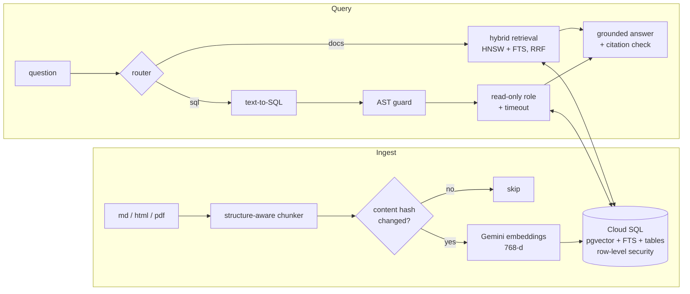

# Quarry

Hybrid RAG over **structured and unstructured** enterprise data, built for Google Cloud:
Gemini on Vertex AI, Cloud SQL for PostgreSQL with pgvector, Cloud Run.

One question can be answered from policy documents, from business tables, or from both at
once ("what is the maximum damage payout for shipment SHP-90003?" needs the liability rule
*and* the shipment's weight and invoice). Every answer cites the evidence it used, and
citations are verified rather than trusted.



## What is in here

| Area | What it does | Where |
|---|---|---|
| Ingestion | Markdown/HTML/PDF loaders, heading-aware chunking with breadcrumbs, content-hash diffing so re-ingestion only embeds changed chunks, one transaction per document | `quarry/ingest.py`, `chunking.py`, `loaders.py` |
| Vector store | pgvector HNSW (cosine) and Postgres full-text in the same table | `quarry/store.py`, `sql/schema.sql` |
| Retrieval | Dense + lexical fused with Reciprocal Rank Fusion | `quarry/retrieval.py` |
| Structured data | Text-to-SQL with a schema card, an AST allow-list guard and one repair round | `quarry/structured.py`, `sqlguard.py` |
| Answers | Router (docs / sql / both), grounded generation, citation verification, abstention | `quarry/answer.py`, `pipeline.py` |
| API | FastAPI, hashed API keys mapped to tenants, per-tenant rate limit, PII-redacted logs | `quarry/api.py`, `security.py` |
| Evaluation | Retrieval ablation, SQL attack suite, ingestion idempotency, end-to-end accuracy/latency/cost, CI gate | `evals/` |
| Deploy | Dockerfile, Cloud Run + Cloud SQL + Secret Manager script, GitHub Actions | `deploy/`, `.github/` |

## Design decisions

**One database for vectors, text search and business tables.** A single transaction-local
setting (`app.tenant_id`) plus row-level security isolates tenants on every path. The API
role is neither owner nor superuser, RLS is `FORCE`d, and an unset tenant sees zero rows.
The tenant always comes from the API key, never from the request body.

**Model-written SQL is untrusted input.** Four independent layers:

1. `sqlguard` parses the query to an AST and allow-lists statement type, tables and
   functions. Unknown functions are rejected by default, which is what stops
   `set_config('app.tenant_id', ...)`, `pg_sleep()`, `pg_read_file()` and `dblink()`.
2. It runs as `quarry_ro`, a role with `SELECT` on four tables and nothing else.
3. The transaction is `READ ONLY` with a statement timeout and a forced `LIMIT`.
4. RLS still applies, so even a perfect injection only reads the caller's own rows.

**Hybrid retrieval.** Embeddings find paraphrases; full-text finds exact identifiers such
as `INV-20417` that embeddings blur. RRF merges the two using ranks only, so their score
scales never need calibrating.

**Idempotent ingestion.** A document's hash short-circuits unchanged files before chunking.
For an edited file, chunks are matched by content hash: unchanged chunks keep their stored
vector and only new text is embedded. If the embedding call fails, the transaction rolls
back and the previous version keeps serving.

**Citations are checked.** Evidence is passed as labelled blocks (`[D1]`, `[S1]`). Labels
the model cites that were never supplied are stripped and the answer is flagged
`grounded: false`. Retrieved text is fenced as data to blunt prompt injection.

## Run it locally

```bash
pip install -e ".[dev]"
make setup          # Postgres+pgvector in Docker, schema, demo data, sample corpus
make test           # 98 tests: units plus integration on the real database
make eval           # offline checks, no API key needed

export GEMINI_API_KEY=...          # or the Vertex AI variables in .env.example
export QUARRY_PROVIDER=gemini
python -m quarry.admin ingest data/docs -t meridian     # re-embed with Gemini
python -m quarry.admin ask "What is the maximum damage payout for SHP-90003?" -t meridian
make eval-e2e       # answer accuracy, groundedness, SQL accuracy, p50/p95, cost per request
```

Switching embedders changes the vectors, so re-ingest after changing `QUARRY_PROVIDER`
(truncate `documents` first, or change a file, because unchanged documents are skipped).

## Deploy to Google Cloud

```bash
PROJECT_ID=your-project REGION=asia-south1 ./deploy/deploy.sh
```

Creates a Cloud SQL Postgres 16 instance, generates secrets in Secret Manager, applies the
schema and RLS through the Cloud SQL Auth Proxy, and deploys the container to Cloud Run
with a least-privilege service account (`cloudsql.client`, `aiplatform.user`,
`secretmanager.secretAccessor`). The service talks to Gemini through Vertex AI using the
service account, so no model API key is stored.

## Evaluation

`python -m evals.run_eval offline` needs no model and runs in CI:

| Check | Result |
|---|---|
| SQL attack suite (DDL/DML, stacked statements, tenant escape, catalog reads, DoS, file access) | 40 / 40 rejected before execution |
| Gold SQL queries wrongly blocked | 0 / 12 |
| Re-ingest of unchanged 12-document corpus | 0 chunks embedded |
| One-section edit of a 6-chunk document | 1 chunk embedded, 5 reused |

Retrieval ablation over 48 paraphrased questions, **offline hash embedder** (a
non-semantic baseline that exists so CI is deterministic; it is not the production model):

| Mode | recall@1 | recall@5 | MRR@10 |
|---|---|---|---|
| lexical (FTS) | 0.458 | 0.854 | 0.604 |
| dense (hash baseline) | 0.438 | 0.583 | 0.503 |
| hybrid (RRF) | 0.479 | 0.792 | 0.612 |

With Gemini embeddings, run `make eval-e2e` and record the numbers here. It reports the same
ablation plus answer accuracy, grounded rate, citation precision, SQL execution accuracy,
p50/p95 latency and average cost per request, and fails the build if they drop below
`evals/thresholds.json`.

## Limits and next steps

- The rate limiter is in-process: exact on one instance, approximate across several.
  Move it to Memorystore before scaling out.
- RLS filters after the HNSW scan. `hnsw.ef_search` is raised per query to compensate;
  pgvector 0.8 iterative scans or per-tenant partial indexes are the fix for very small
  tenants in a very large table.
- Embedding happens inside the ingest transaction, which keeps a connection open during a
  network call. Fine for document-at-a-time ingestion; batch pipelines should embed first.
- No reranker yet. A cross-encoder or Gemini rerank over the fused top 24 is the next
  retrieval improvement to measure.
